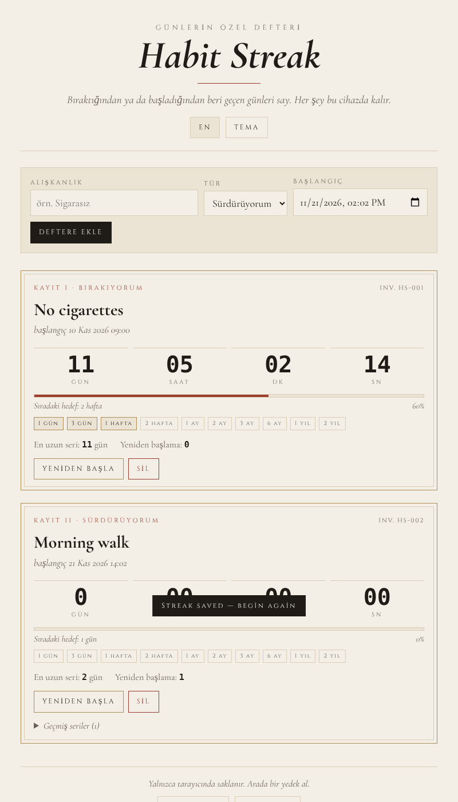

# Habit Streak

A small, private counter for the habits you are quitting or keeping.

- Live clock: days, hours, minutes and seconds since you started
- Milestones from 1 day to 2 years, with a progress bar to the next one
- Restarting saves the old streak to history and tracks your best streak
- English and Turkish, light and dark theme
- Export and import your data as JSON
- No account, no server: everything is stored in your browser (`localStorage`)

## Use it

Open `index.html` in any browser — that's it. To use it on your phone, enable **GitHub Pages** for this repository (Settings → Pages → deploy from `main`) and open the link.

## License

MIT
